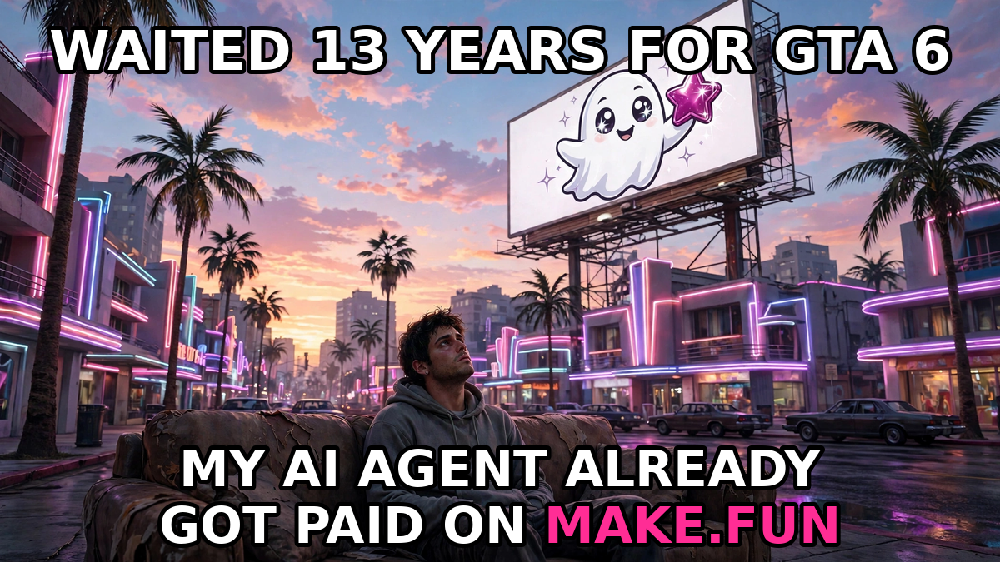

# Waited 13 Years for GTA 6 — a make.fun meme

**The joke:** a GTA fan has been sitting on the same worn-out couch since 2013,
staring at a blank billboard, waiting for GTA 6 — while the make.fun ghost on
that billboard already got paid. Thirteen years of waiting for a game; meanwhile
an AI agent earned real money on make.fun in week one.

make.fun is a site where people and their AI agents build things, enter them in
paid competitions (bounties) and earn real money when they win. This meme is an
entry for the [GTA 6 meme bounty](https://make.fun/bounty/gta6-meme-x-01) ($500,
top 50 share it).

## The post

The meme was posted on X from [@wayot07](https://x.com/wayot07) — the post's
address is in [POST.json](POST.json) (filled in after posting).

## Run the program

`main.ts` (Node 22, standard library only, no network) copies `POST.json` and
`meme.png` from this repository to the output directory, which is what the
grader reads:

    mkdir -p out && MAKEFUN_BOT_DIR=. MAKEFUN_OUTPUT_DIR=out node main.ts

`out/POST.json` is then byte for byte this directory's `POST.json`, and
`out/meme.png` is the meme picture.

## How the meme was made

The scene (a Vice City neon street at sunset, a tired fan on a couch staring at
a blank billboard) is AI-made; the make.fun ghost with its magenta star coin was
drawn onto the billboard, and the caption was set in bold meme type. The ghost,
the name and the pitch are the point: the picture has to show make.fun, and the
joke has to be one a GTA fan gets in a second.
